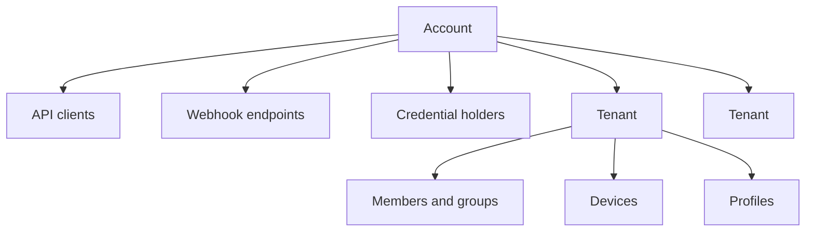

import { Tabs, TabItem } from '@astrojs/starlight/components';


An **account** is a customer of mdm. A **tenant** is an isolated space inside one account: a family, a company, a school.



## Account

The operator creates the account and registers its API clients and browser origins. The API cannot. An API client reaches every tenant of its account, limited by its [scopes](/mdmsdk/guides/authentication/#scopes).

## Tenant

Members, groups, devices, and profiles belong to one tenant. Nothing crosses from one tenant to another: a resource of another tenant answers 404.

| Field | Meaning |
|---|---|
| `id` | A UUID. |
| `external_id` | Your own id for the tenant, unique in the account. Letters, digits, and `. _ ~ @ : -`. |
| `name` | A display name you set. |
| `holder_id` | The [credential holder](/mdmsdk/concepts/apple-credentials/) it uses. Null means the account's default. |
| `min_os` | The iOS version its devices must reach. Null means the latest for each model. |
| `licence` | Device and people limits, how much is used, and when it ends. |

## Address a tenant by your id

Anywhere a call takes a tenant, send its `id` or `ext:` followed by your `external_id`.

<Tabs syncKey="lang">
  <TabItem label="Go">
    ```go
    tenant, err := client.Tenants.Create(ctx, api.TenantRequest{
    	Name:       "Rivera family",
    	ExternalId: new("crm-42"),
    })
    if err != nil {
    	return err
    }

    for device, err := range client.Devices.List(ctx, "ext:crm-42", nil) {
    	if err != nil {
    		return err
    	}
    	fmt.Println(device.Name, device.Status)
    }
    ```
  </TabItem>
  <TabItem label="Python">
    ```python
    from mdmsdk.models import TenantRequest

    tenant = client.tenants.create(TenantRequest(name="Rivera family", external_id="crm-42"))

    for device in client.devices.list("ext:crm-42"):
        print(device.name, device.status)
    ```
  </TabItem>
</Tabs>

Every list method returns an iterator.

## Licence

A write over a limit answers 409 with code `licence_exceeded`. After the licence ends, adding devices, profiles, settings, assignments, members, and groups answers 409 with code `licence_expired`. Reads, removals, and DeviceLock keep working. Neither is retried: the answer does not change until the licence does.

## Deleting a tenant

Deletion is asynchronous. The request answers at once, and then:

1. `tenant.deleting` fires. Writes to the tenant answer 409 with code `tenant_deleting`. Reads keep working. No delegated token is issued for it.
2. Every enrolled device is asked to remove its enrollment profile.
3. Once each device has removed it, checked out, or stayed silent for 30 days, the tenant and everything in it are deleted and `tenant.deleted` fires.
