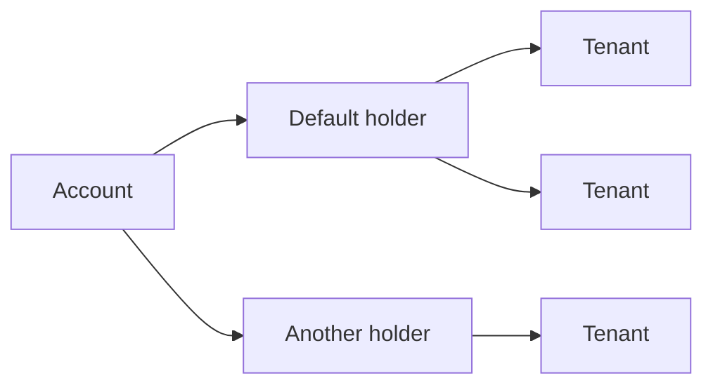
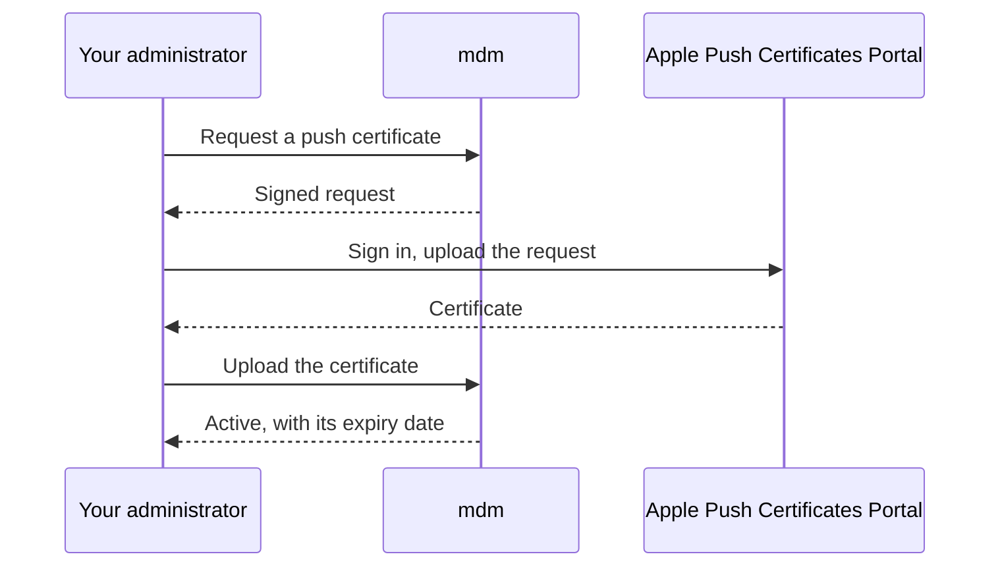

Apple issues device management credentials to the organization that manages the devices. A **credential holder** is that organization in mdm: the legal entity that accepted Apple's agreements.

## Holders

Every account has a default holder. A tenant uses it unless it names another holder of the same account. An account that serves several separate companies creates one holder per company.

## Credentials

| Credential | What it does | Where the organization gets it |
|---|---|---|
| Push certificate | Wakes devices so they check in. A tenant cannot enroll a device until its holder has one. | Apple Push Certificates Portal |
| Automated Device Enrollment token | Devices the organization bought enroll, supervised, when they are activated. | Apple Business Manager or Apple School Manager |
| Apps and Books token | Assigns licensed apps. | Apple Business Manager |

All three need the `account:credentials` scope. A delegated token never reaches them.

## Push certificate

- Sign in to Apple's portal with an Apple Account that belongs to the organization, not to a person, so the certificate survives staff changes.
- The private key stays in mdm and is never returned.
- To renew, request again and choose **Renew** on the existing certificate in Apple's portal, never **Create**. A new certificate has a new topic, and every enrolled device would have to enroll again. mdm refuses such an upload while devices are enrolled.
- `push_certificate.expiring` fires before the certificate ends.
- An organization that already has a certificate and its key uploads both.

## Moving a tenant

Changing a tenant's holder affects devices that enroll afterwards. Devices already enrolled keep the push topic they enrolled with.
