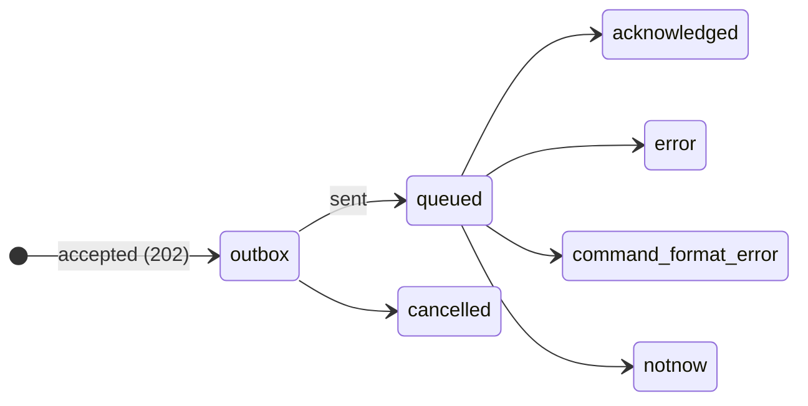

import { Tabs, TabItem } from '@astrojs/starlight/components';


A **command** asks one enrolled device to do something now. Sending one is asynchronous: the API accepts it, and the device answers later.

| Type | Effect | Fields |
|---|---|---|
| `DeviceLock` | Locks the device. | `message` and `phone_number`, shown on the Lock Screen. |
| `DeviceInformation` | Asks the device for its model, OS version, and level. | none |

## Lifecycle



| Status | Meaning |
|---|---|
| `outbox` | Accepted and not sent yet. |
| `queued` | Sent, waiting for the device. |
| `acknowledged` | The device ran it. `result` carries its report. |
| `error` | The device refused it. `error` carries the device's error chain. |
| `command_format_error` | The device could not read it. |
| `notnow` | The device answered that it cannot run it now, for example while locked. |
| `cancelled` | It never reached the device: its enrollment ended, or a newer decision replaced it. |

## Sending

The response is 202 with a `command_uuid`. Keep it: it names the command when you read it back and in the webhook.

<Tabs syncKey="lang">
  <TabItem label="Go">
    ```go
    tenant := "ext:crm-42"

    accepted, err := client.Commands.Send(ctx, tenant, deviceID, api.CommandRequest{
    	Type:    api.DeviceLock,
    	Message: new("Lost phone."),
    })
    if err != nil {
    	return err
    }

    command, err := client.Commands.Get(ctx, tenant, deviceID, accepted.CommandUuid)
    if err != nil {
    	return err
    }
    fmt.Println(command.Status)
    ```
  </TabItem>
  <TabItem label="Python">
    ```python
    from mdmsdk.models import CommandRequest, CommandRequestType

    tenant = "ext:crm-42"

    accepted = client.commands.send(
        tenant,
        device_id,
        CommandRequest(type_=CommandRequestType.DEVICELOCK, message="Lost phone."),
    )

    command = client.commands.get(tenant, device_id, accepted.command_uuid)
    print(command.status)
    ```
  </TabItem>
</Tabs>

Only an enrolled device takes commands. Any other device answers 409 with code `conflict`.

## Learning the result

Subscribe to `command.completed`: it is the signal to prefer. Without a webhook, read the command by its `command_uuid` until its status is no longer `outbox` or `queued`.

For `DeviceInformation`, `result` carries `QueryResponses`. The device's fields (`model`, `os_version`, `supervised`) are updated from it as well.
