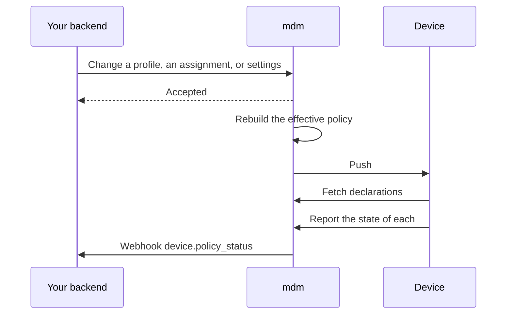

Policy reaches a device only as **declarations**, Apple's declarative device management. A write changes what mdm wants; the device reports what is in force.

## A write is not the result

The response to a write says the change was stored. It does not say the device applied it. Read the device, or wait for `device.policy_status`, to learn that.

## Policy status

Each rebuild that changes the result increments the policy's `revision` and sets its status to `pending`.

| Status | Meaning |
|---|---|
| `pending` | Built, and the device has not reported every declaration yet. |
| `applied` | The device reported every declaration valid and active. |
| `failed` | The device reported a declaration invalid. `error` carries Apple's reason. |
| `removing` | The policy is being removed. |

## Item status

A device lists one status per policy item, in policy order.

| Status | Meaning |
|---|---|
| `pending` | Waiting for the device, or its level or OS is not known yet. |
| `applied` | The device accepted and activated the setting. |
| `failed` | The device reported the setting invalid. |
| `removing` | The policy is being removed. |
| `unsupported` | The device cannot take the setting. `reason` says why. |

| Reason | Meaning |
|---|---|
| `requires_supervision` | The setting needs a supervised device. |
| `requires_os` | The setting needs a newer OS. `min_os` names the version. |
| `not_supported_by_device` | The device does not list the declaration type it needs. |

## Rules

- A device below iOS or iPadOS 17 gets no declarations.
- A device whose level and OS are not known yet gets its declarations once it reports them.
- An unsupported item is left out of the device's declarations and stays in the policy.
- The device's declarative management state lists each current declaration with the version mdm holds, the version the device last reported, and whether it is active and valid.
