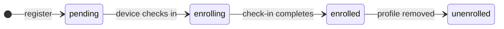

import { Tabs, TabItem } from '@astrojs/starlight/components';


A device is an iPhone or iPad registered in a tenant. Its **level**, supervised or unsupervised, decides which settings it can take.

## Enrollment



1. Register the device. It starts in status `pending`, and the response carries its enrollment profile.
2. Get the profile onto the device. Create an enrollment link and open it on the device, or show it as a QR code. The link works for 24 hours, until the device enrolls, or until you issue a new link or profile. Treat it as a secret until then.
3. The device installs the profile and checks in. Its status turns `enrolled` and `device.enrolled` fires.

<Tabs syncKey="lang">
  <TabItem label="Go">
    ```go
    created, err := client.Devices.Create(ctx, "ext:crm-42", api.CreateDeviceRequest{
    	Name:   "Ella's iPhone",
    	Member: new("ext:user-7"),
    })
    if err != nil {
    	return err
    }

    link, err := client.Devices.CreateEnrollmentLink(ctx, "ext:crm-42", created.Device.Id)
    if err != nil {
    	return err
    }
    fmt.Println(link.Url, link.ExpiresAt)
    ```
  </TabItem>
  <TabItem label="Python">
    ```python
    from mdmsdk.models import CreateDeviceRequest

    created = client.devices.create("ext:crm-42", CreateDeviceRequest(name="Ella's iPhone", member="ext:user-7"))

    link = client.devices.create_enrollment_link("ext:crm-42", created.device.id)
    print(link.url, link.expires_at)
    ```
  </TabItem>
</Tabs>

The enrollment credentials in a profile last 7 days. Issuing a new profile or link invalidates the earlier ones. Both answer 409 once the device is enrolled. An unenrolled device enrolls again with a new profile.

## Level

| Level | How a device gets it | Settings |
|---|---|---|
| `supervised` | Set up through Apple Configurator or Automated Device Enrollment. | Every setting in the catalog. |
| `unsupervised` | Its owner installs the enrollment profile. | The settings Apple allows without supervision. |

The device reports its level after it enrolls. Until then `supervised` is null, and it is null again after each new enrollment until the device reports.

A setting the device's level cannot take is not an error. It stays in the policy and its status is `unsupported` with reason `requires_supervision`. Ask the [catalog](/mdmsdk/quickstart/#list-the-catalog-for-a-level) which settings a level takes before you offer them.

## OS version

| Field | Meaning |
|---|---|
| `os_version` | The version the device reported. |
| `os_latest` | The newest version Apple publishes for its model. |
| `os_behind` | True when the device is below the tenant's `min_os`, or below `os_latest` when the tenant sets none. |

A device that falls behind raises `device.os_behind`. Declarations need iOS or iPadOS 17: a device below that gets none.

## Removing a device

Removing a device ends its record: later calls on it answer 404. The device itself stays enrolled until it is erased or its enrollment profile is removed.
