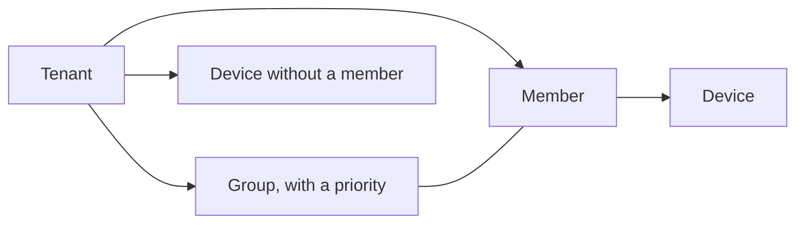

A **member** is a person as an owner of devices, not a sign-in. A **group** is a flat set of members.

## Member

mdm stores your id for the person and a display name. It holds no email address, phone number, or other contact data.

| Field | Meaning |
|---|---|
| `id` | A UUID. |
| `external_id` | Your own id for the person, unique in the tenant. |
| `name` | A display name. |
| `groups` | The ids of the member's groups. |

Anywhere a path or a body takes a member, send its `id` or `ext:` followed by your `external_id`.

## Group

A group has a `name` and a `priority`. The priority is unique in the tenant. Groups do not nest. A member belongs to any number of groups.

When two groups give a device the same setting, the group with the higher priority wins. See [the policy merge](/mdmsdk/concepts/profiles/#the-merge).

## Devices

A device belongs to one member or to the tenant itself. Give a device to a member, or back to the tenant, at any time. Its policy is rebuilt when you do.

## Reach

A [delegated token](/mdmsdk/guides/authentication/#delegated-tokens) names members or groups. It reaches those members and their devices and nothing else in the tenant. A token for groups reaches whoever is in the groups when each request is served, so a membership change takes effect at once.
