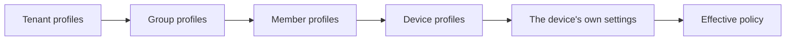

import { Tabs, TabItem } from '@astrojs/starlight/components';


A **profile** is a named list of settings in a tenant. It reaches devices through **assignments**. Each device's **effective policy** is the merge of every profile that reaches it and the device's own settings.

## Items

A profile holds items. Each item names a catalog entry and gives it a value or a payload:

```json
{
  "name": "Minors",
  "items": [
    { "id": "restriction:allowCamera", "value": false },
    { "id": "declaration:passcode.settings", "payload": { "MinimumLength": 6 } },
    { "id": "profile:com.apple.wifi.managed", "key": "home", "payload": { "SSID_STR": "Home" } }
  ]
}
```

An entry that can be added more than once, such as a Wi-Fi network, takes a `key` that names the instance.

## Assignments

An assignment gives one profile to one target for the listed levels.

| Target | Reaches |
|---|---|
| `tenant` | Every device in the tenant. |
| `group` | The devices of the group's members. |
| `member` | The member's devices. |
| `device` | One device. |

`levels` is `supervised`, `unsupervised`, or both. An assignment applies to a device only when it lists the device's level. A profile has one assignment per target: a second one answers 409.

<Tabs syncKey="lang">
  <TabItem label="Go">
    ```go
    profile, err := client.Profiles.Create(ctx, "ext:crm-42", api.ProfileRequest{
    	Name:  "Minors",
    	Items: []api.PolicyItem{{Id: "restriction:allowCamera", Value: false}},
    })
    if err != nil {
    	return err
    }

    _, err = client.Assignments.Create(ctx, "ext:crm-42", profile.Id, api.AssignmentRequest{
    	Target:   api.AssignmentRequestTargetMember,
    	TargetId: new("ext:user-7"),
    	Levels:   []api.AssignmentRequestLevels{api.AssignmentRequestLevelsSupervised},
    })
    ```
  </TabItem>
  <TabItem label="Python">
    ```python
    from mdmsdk.models import (
        AssignmentRequest,
        AssignmentRequestLevelsItem,
        AssignmentRequestTarget,
        PolicyItem,
        ProfileRequest,
    )

    profile = client.profiles.create(
        "ext:crm-42",
        ProfileRequest(name="Minors", items=[PolicyItem(id="restriction:allowCamera", value=False)]),
    )

    client.assignments.create(
        "ext:crm-42",
        profile.id,
        AssignmentRequest(
            target=AssignmentRequestTarget.MEMBER,
            target_id="ext:user-7",
            levels=[AssignmentRequestLevelsItem.SUPERVISED],
        ),
    )
    ```
  </TabItem>
</Tabs>

## The merge



- Layers apply from left to right. A more specific layer replaces the same item from a less specific one.
- Two items are the same when their `id` and `key` match.
- Between groups, the higher `priority` wins.
- When two profiles in one layer set the same item, the profile with the lower id wins. The pair is reported as a conflict. A conflict never blocks delivery.
- Until the device reports its level, only its own settings apply.

Read the result from the device's effective policy (`client.Devices.EffectivePolicy` in Go, `client.devices.effective_policy` in Python). Each item carries its `source`, the sources it overrode in `overridden`, and its `conflicts`.

## Secrets

Keys the catalog marks `secret` are write-only. A response shows `{"secret": "set"}` in place of the value. On a write, send that object back to keep the stored value, send a string to replace it, or leave the key out to clear it.

## What happens after a write

Changing a profile, an assignment, a group's members or priority, a device's member, or a device's settings rebuilds the effective policy of every device it reaches. The result reaches each device as [declarations](/mdmsdk/concepts/declarations/).
