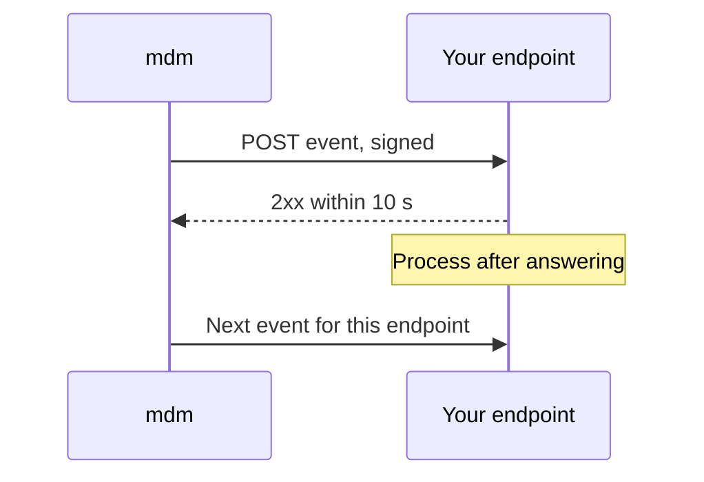

A **webhook endpoint** is an HTTPS URL of your account that receives its events. Events carry ids and states, not device details: read the rest through the API.

## Events

| Type | Fires when |
|---|---|
| `device.enrolled` | A device finishes enrolling. |
| `device.unenrolled` | A device's enrollment ends. |
| `device.policy_status` | The state of a device's policy items changes. |
| `device.os_behind` | A device falls behind the OS version it must reach. |
| `command.completed` | A device answers a command. |
| `push_certificate.expiring` | A credential holder's push certificate nears its end. |
| `tenant.deleting` | A tenant's deletion starts. |
| `tenant.deleted` | A tenant's deletion finishes. |

An endpoint subscribes to the types in its `events`. An empty list takes every event.

## Shape

The body is JSON with `type`, `timestamp`, and `data`. Each delivery is signed per Standard Webhooks with three headers: `webhook-id`, `webhook-timestamp`, and `webhook-signature`. The signing secret starts with `whsec_` and is shown once, when the endpoint is created or its secret is rotated.

## Delivery

- One delivery at a time per endpoint, in order.
- A failed delivery is retried after 5 s, 5 m, 30 m, 2 h, 5 h, 10 h, 14 h, 20 h, and 24 h.
- After the last attempt, or on an answer of 410, the endpoint is disabled.
- The URL must be `https` and resolve to a public address. Redirects are not followed.
- An account has at most 20 endpoints.

[Receiving webhooks](/mdmsdk/guides/webhooks/) has the rules a receiver must follow and the code to verify a delivery.
