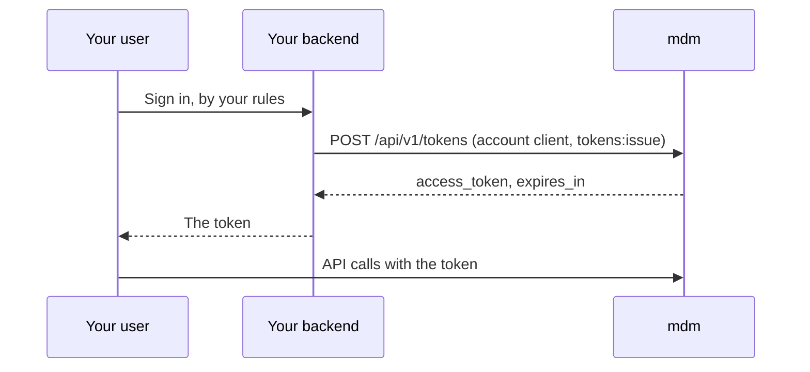

import { Tabs, TabItem } from '@astrojs/starlight/components';

The API has two kinds of caller you can hold credentials for.

| Caller | Credential | Reaches |
|---|---|---|
| Account client | OAuth client credentials | Every tenant of your account, limited by the client's scopes. |
| Delegated token | A token your backend asks the API for | One tenant, the members or groups you list or all of it, the permissions you list, for at most 900 seconds. |

## Account client

The operator registers the client and gives you its id and secret. Keep the secret on your backend.

<Tabs syncKey="lang">
  <TabItem label="Go">
    ```go
    client, err := mdmsdk.New(
    	mdmsdk.WithClientCredentials(id, secret),
    	mdmsdk.WithActor("user-7"),
    )
    ```
  </TabItem>
  <TabItem label="Python">
    ```python
    client = mdmsdk.Client(client_id=id, client_secret=secret, actor="user-7")
    ```
  </TabItem>
</Tabs>

The SDK fetches a token, caches it, and refreshes it 60 seconds before it expires. One fetch runs at a time.

`actor` is sent as the `Mdm-Actor` header. It names the user your backend acts for in the audit trail. It grants nothing.

### Scopes

| Scope | Allows |
|---|---|
| `tenants:read`, `tenants:write` | List, read, create, update, and delete tenants. |
| `members:read`, `members:write` | Members, groups, and group membership. |
| `devices:read`, `devices:write` | Devices, enrollment links and profiles, declaration state, command results. |
| `profiles:read`, `profiles:write` | Profiles, assignments, device settings, effective policy. |
| `commands:write` | Send commands. |
| `tokens:issue` | Issue delegated tokens. |
| `account:webhooks` | Webhook endpoints and their secrets. |
| `account:credentials` | Credential holders and their Apple credentials. |

A call without the scope answers 403 with code `insufficient_scope`.

## Delegated tokens



Your backend decides who your user is and what they may reach. Then it asks for a token that says exactly that:

```sh
curl https://enroll.dev/api/v1/tokens \
  -H "Authorization: Bearer $ACCOUNT_CLIENT_TOKEN" \
  -H "Content-Type: application/json" \
  -d '{
    "tenant": "ext:crm-42",
    "subject": "user-7",
    "members": ["ext:user-9"],
    "permissions": ["devices:read", "commands:write"],
    "ttl": 600
  }'
```

```json
{ "access_token": "eyJ...", "token_type": "Bearer", "expires_in": 600 }
```

| Field | Rule |
|---|---|
| `tenant` | One tenant of your account, by id or `ext:` reference. |
| `subject` | Your id for the user. Recorded, never interpreted. |
| `members`, `groups`, `all` | Exactly one of them. Up to 100 members or groups, or `"all": true` for the whole tenant. |
| `permissions` | At least one of `devices:read`, `devices:write`, `profiles:read`, `profiles:write`, `commands:write`, `members:read`. Each must be a scope the client holds. |
| `ttl` | Seconds. At most 900, and 900 when absent. |

Use the token as a fixed credential:

<Tabs syncKey="lang">
  <TabItem label="Go">
    ```go
    delegated, err := mdmsdk.New(mdmsdk.WithToken(accessToken))
    ```
  </TabItem>
  <TabItem label="Python">
    ```python
    delegated = mdmsdk.Client(token=access_token)
    ```
  </TabItem>
</Tabs>

### Rules

- A delegated token is never refreshed. Ask for a new one before it expires.
- A token for `groups` reaches the members in those groups when each request is served.
- Tenants, member and group writes, token issuing, webhooks, and Apple credentials are never delegated. Such a call answers 403 with code `not_delegable`.
- Creating or editing profiles, and assigning to the tenant or a group, needs a token with `all`. Otherwise the call answers 403 with code `needs_all`.
- A device without a member is reached only with `all`.
- Anything outside the token's reach answers 404, not 403. A reachable resource without the permission answers 403 with code `insufficient_permission`.
- Revoking a user is your rule changing: stop issuing tokens for them. Tokens already issued last until they expire.
- Tokens are signed with ES256. The public keys are at `/api/.well-known/jwks.json`.
