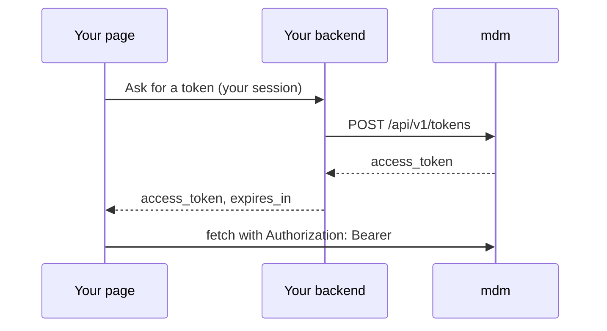

A page can call the API directly with a [delegated token](/mdmsdk/guides/authentication/#delegated-tokens). There is no TypeScript SDK: the page uses `fetch`.



## Before you start

- Ask the operator to register the origin your page is served from, such as `https://app.example.com`. The API cannot register one.
- Add an endpoint to your backend that checks your own session and returns a delegated token for that user.

## Call the API

```ts
interface DelegatedToken {
  access_token: string;
  expires_in: number;
}

interface Problem {
  status: number;
  title: string;
  code?: string;
  detail?: string;
  instance?: string;
}

const api = 'https://enroll.dev/api/v1';
let cached: { token: string; expiresAt: number } | undefined;

// Your backend's endpoint. It issues a token for the signed-in user.
async function delegatedToken(): Promise<string> {
  if (cached && Date.now() < cached.expiresAt - 60_000) {
    return cached.token;
  }
  const res = await fetch('/session/mdm-token', { method: 'POST' });
  if (!res.ok) {
    throw new Error(`token request failed: ${res.status}`);
  }
  const body: DelegatedToken = await res.json();
  cached = { token: body.access_token, expiresAt: Date.now() + body.expires_in * 1000 };
  return cached.token;
}

export async function call<T>(path: string, init: RequestInit = {}): Promise<T> {
  const res = await fetch(`${api}${path}`, {
    ...init,
    headers: { ...init.headers, Authorization: `Bearer ${await delegatedToken()}` },
  });
  if (!res.ok) {
    const problem: Problem = await res.json();
    // Branch on problem.code; quote problem.instance when reporting.
    const what = problem.detail ?? problem.title;
    throw new Error(`${problem.code ?? res.status}: ${what} (${problem.instance})`);
  }
  return res.json();
}
```

```ts
const devices = await call<Device[]>('/tenants/ext:crm-42/devices');
```

Take the types, such as `Device`, from the [contract](/mdmsdk/reference/).

## Rules

- The API serves a browser only for a delegated token whose account registered the page's origin. An account client token sent from a browser is refused, so the client secret never belongs in a page.
- A browser reaches the tenant paths (`/api/v1/tenants/...`), `/api/v1/catalog`, and `/api/v1/me`.
- A page can send `Authorization`, `Content-Type`, and `Idempotency-Key`, and read `Retry-After` and `Idempotent-Replayed` from a response.
- Keep the token in memory. It lasts at most 900 seconds, and your backend issues the next one.
- Retries are yours to write in the browser. Follow [the retry table](/mdmsdk/guides/idempotency-and-retries/#what-is-retried).
