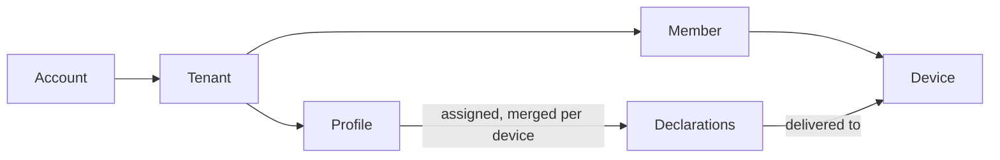

import { Tabs, TabItem } from '@astrojs/starlight/components';
import Terminal from '../../components/Terminal.astro';



<Tabs syncKey="lang">
  <TabItem label="Go">
    ```sh
    go get github.com/qbranchio/mdmsdk
    ```
  </TabItem>
  <TabItem label="Python">
    ```sh
    pip install mdmsdk
    ```
  </TabItem>
</Tabs>

<Terminal quickstart="/mdmsdk/quickstart/" />
